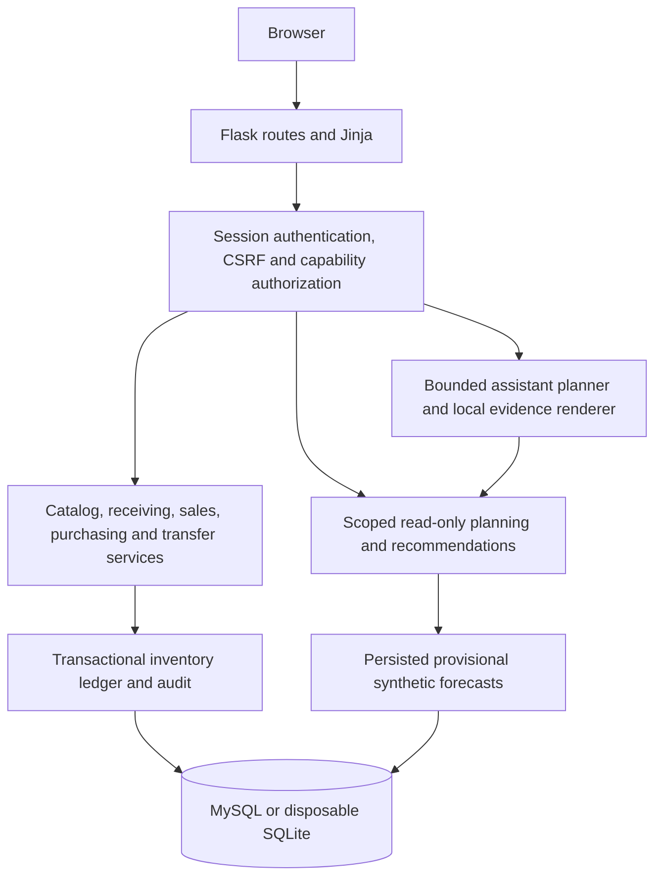

# InventraIQ architecture

InventraIQ uses Flask routes, server-rendered Jinja pages and local CSS/vanilla JavaScript. SQLAlchemy targets MySQL or disposable SQLite. JSON routes support page interactions and scoped service contracts.

`authz.py` resolves current HQ grants and branch assignments. Portal roles alone confer no business authority. Domain services enforce capabilities, scope, revisions and transactional boundaries. Stock movements and their audit evidence commit together; failed operations roll back. Transfers preserve independent approval. See [permission inventory](T05_PERMISSION_INVENTORY.md) and [security](SECURITY.md).

The retained compatibility path in `ai_model.py`, `intelligence.py` and `inventory_transactions.py` includes request-time seven-day regression and legacy product-stock workflows. It is an earlier vertical slice, not a complete description of current branch services. Legacy `Prediction` compatibility is distinct from the persisted forecast snapshot system.

`forecasting/data.py` reconstructs authorized branch/SKU historical series with explicit coverage. Offline synthetic jobs in `forecasting/jobs.py` generate versioned provisional seasonal-baseline snapshots, publish an atomic batch and retain provenance, hashes and publication state. Reads validate scope, freshness and integrity. No scheduler is installed; snapshot reads do not initiate model training. The retained legacy request-time path fits regression models as described above. See [data contract](forecasting/README.md), [evaluation](forecasting/EVALUATION.md) and [snapshots](forecasting/SNAPSHOTS.md).

`services/recommendations.py` combines eligible snapshots with stock, expiry, inbound visibility and explicit reviewed synthetic policies. Missing or unauthorized inputs withhold quantities. Recommendation arithmetic is policy, not model confidence or permission to execute.

The assistant uses authenticated, scoped read tools. The default provider is fake. Optional Gemini makes a bounded synthetic planning request; tool results and factual explanations stay local. Proposal functionality is a separate disabled-by-default path requiring ordinary capability checks and human review. See [Gemini boundary](T26_STAGE_B_GEMINI.md).

Models describe current schemas. Startup does not migrate existing databases. All migration artifacts are retained byte-for-byte; historical SQL is not a universal bootstrap. [Local setup](docs/LOCAL_SETUP.md) describes disposable SQLite demos and the limitations of host-specific MySQL operator helpers. No existing development target is required by the demos. Production deployment and existing-schema cutover require separate operational review.
