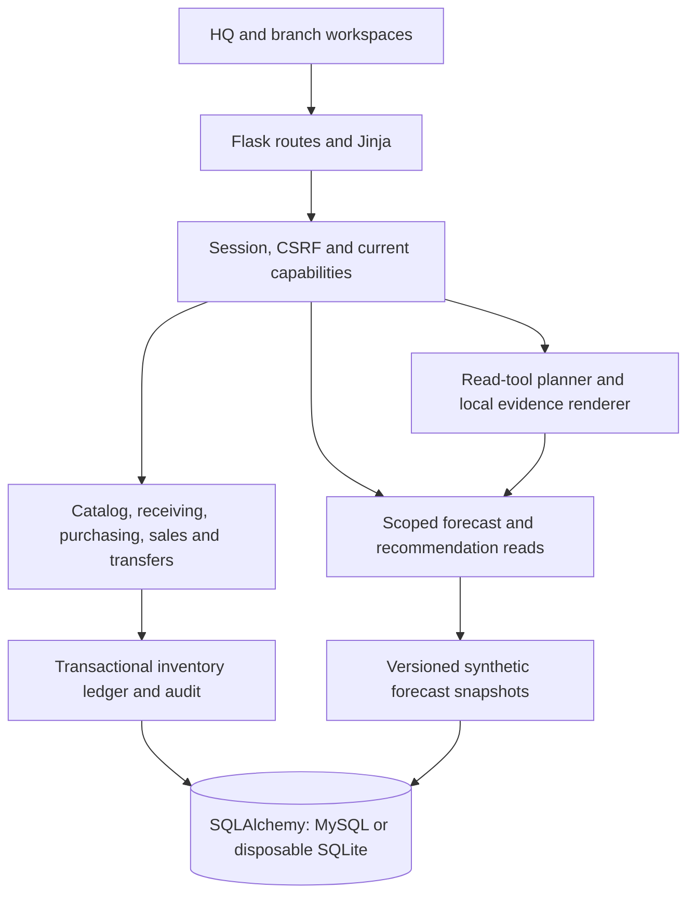

# InventraIQ

InventraIQ is an inventory and decision-support application built with Flask, SQLAlchemy and server-rendered Jinja workspaces. It connects branch inventory, receiving, purchasing, sales and transfers through shared transactional services, with explicit permissions and traceable business facts.

The project develops the owner's original SmartShelf implementation into a distinct software engineering portfolio project. Historical acknowledgments and licensing scope are documented in [ATTRIBUTION.md](ATTRIBUTION.md). This release is prepared as a source-only snapshot for independent Git history.

## Engineering capabilities

- **Multi-branch operations:** explicit HQ grants and active branch assignments govern consolidated reporting and branch-scoped workflows. HQ analysts are read-only; managers and clerks receive different capabilities. Independent approval separates requests from approval authority.
- **Transactional inventory:** lot balances, expiry-aware FEFO allocation, reservations, priced sales/refunds, purchasing and transfer workflows share domain services. Conditional updates, revision checks, idempotent operation identities and transactional audit records protect supported write paths against stale or duplicate effects.
- **Security boundaries:** revocable sessions, database-backed login throttling, session-bound CSRF, bounded inputs, scoped queries and sanitized failures. Failed operations roll back their related stock, financial and audit changes together.
- **Explainable planning:** authorized historical series, versioned synthetic forecast snapshots and explicit recommendation policies distinguish observations, missing evidence and proposed quantities. Planning previews do not execute inventory actions.
- **Bounded assistant:** typed read tools, schema validation, current permission checks, evidence provenance and a local factual renderer. An optional Gemini adapter plans tool calls within a synthetic demonstration boundary.

## Stack and architecture

| Layer | Technology and responsibility |
| --- | --- |
| Web | Python 3.14 reference environment, Flask, Jinja, local CSS and vanilla JavaScript |
| Data | SQLAlchemy; disposable SQLite demos and MySQL operational support |
| Access control | Flask-Login sessions, explicit HQ/branch capabilities and CSRF |
| Inventory | Shared domain services, immutable committed ledger facts and transactional audit |
| Forecasting | NumPy, pandas and scikit-learn; chronological offline comparison and provisional seasonal-baseline snapshots |
| Assistant | Deterministic default provider; optional standard-library HTTPS Gemini adapter |
| Verification | unittest, disposable fixtures, concurrency checks and mocked provider tests |



Branch scope is enforced by server-resolved grants and query predicates. Portal labels alone grant no business authority. The retained legacy product-stock/regression path is distinct from the current branch services and persisted forecast system. See [architecture](ARCHITECTURE.md), [permission inventory](T05_PERMISSION_INVENTORY.md), [security](SECURITY.md) and [recommendation contracts](services/RECOMMENDATIONS.md).

## Forecasting methodology and measured evidence

Historical-data contracts preserve observed/missing masks and branch/SKU identities. Offline evaluation uses expanding chronological origins, shifted lag/calendar features and preprocessing fitted within each training fold. Operational simulation sales do not enter those historical features. Fixed candidates include persistence and seasonal baselines, regression, Ridge and histogram gradient boosting; promotion requires improvement, branch safety and coverage gates.

The [recorded comparison](T19_MODEL_COMPARISON.md) uses 36 synthetic branch/SKU series, four weekly validation origins and 144 fold-series forecasts. It scores 953 observed daily labels across 89 complete and 55 partial seven-day horizons.

| Recorded result | Value |
| --- | --- |
| Provisional selection | Two-week seasonal mean (`seasonal_mean2`) |
| Daily MAE | 0 units |
| WAPE | 0% |
| Mean signed daily bias | 0 units |
| Sum of absolute complete-week total errors | 0 units |
| MASE / RMSSE | Undefined: seasonal training scales are zero |
| ML candidates passing promotion | None |
| Fully protocol-eligible series / locked-test evaluations | 0 / 0 |

The zero-error seasonal baseline arises from repeating weekly synthetic demand patterns. It demonstrates consistency on that fixture, not real-world forecast accuracy. Neither shipped synthetic profile supplies enough history for the full locked-test protocol. Missing observations remain unknown; sparse/intermittent comparative accuracy and stockout-censored demand are not established.

Snapshots retain provenance, version and integrity checks. Their seasonal baseline is provisional, with no automatic scheduler or real-data publication. Recommendation quantities are policy calculations over eligible forecasts and authorized stock/inbound evidence, not confidence estimates or permission to purchase. See [historical data](forecasting/README.md), [evaluation protocol](forecasting/EVALUATION.md), [snapshot contracts](forecasting/SNAPSHOTS.md) and [intelligence boundaries](INTELLIGENCE.md). No new training or evaluation was performed for this documentation update.

## Gemini architecture and boundaries

The default assistant is deterministic and offline. Optional Gemini performs one bounded planning round using fixed allowed synthetic questions and static read-tool schemas. Authenticated local dispatch validates the proposed calls and rechecks scope; factual explanations are rendered locally. Business rows, conversation history and tool results are excluded from the external planning payload, and provider narrative is not rendered as evidence.

The adapter requires explicit enablement, a backend key, project-tier attestation, loopback, non-debug development/testing and an attested disposable synthetic SQLite target. It rejects production/MySQL use and arbitrary prompts. Budgets, duplicate-call rejection, bounded workers and quota latching constrain attempts; there is no automatic retry or paid/model fallback. These local limits do not guarantee billing, provider availability or production privacy. Cross-branch urgency-ranking reliability is not independently established. See [Gemini controls](T26_STAGE_B_GEMINI.md).

## Reproduce the synthetic demo

Reference installation: WSL Ubuntu x86-64 with Python 3.14.4. From the release root:

```bash
python3.14 -m venv .venv
.venv/bin/python -m pip install -r requirements.txt -c constraints/portfolio-python314.txt
.venv/bin/python -m pip check
export PYTHON_DOTENV_DISABLED=1 PYTHONDONTWRITEBYTECODE=1
export OPENBLAS_NUM_THREADS=1 OMP_NUM_THREADS=1
export ASSISTANT_PROVIDER=fake GEMINI_ENABLED=false ASSISTANT_PROPOSALS_ENABLED=false
unset GEMINI_API_KEY
.venv/bin/python -B scripts/run_demo.py --check
.venv/bin/python -B scripts/run_product_review.py --check
.venv/bin/python -B scripts/run_product_review.py
```

The populated demo privately prompts for a temporary password and serves five synthetic roles at `http://127.0.0.1:5055/roles`. Each launch creates its own temporary database, accepts no existing target and removes the fixture on normal shutdown. All stock, money and demand are simulated; the business clock is pinned. No real dataset, shipped account credential or Gemini request is required.

[Local setup](docs/LOCAL_SETUP.md) explains configuration, grants and platform limits. MySQL operator helpers retain host-specific assumptions and require separate review. Dependency constraints pin versions, not wheel hashes; alternate platforms are not certified.

## Testing and release verification

```bash
export APP_ENV=testing DATABASE_URL=sqlite:///:memory:
PYTHONPATH=tests .venv/bin/python -B -m unittest test_database_configuration test_authentication_hardening test_phase1_singletons -v
.venv/bin/python -B scripts/render_phase1_singletons.py --check
```

Initial export verification passed a fresh 27-distribution dependency installation and `pip check`, both SQLite demo checks, five populated-demo role logins, stock reconciliation and loopback HTTP startup checks. The focused release selection passed 63 tests directly. One additional Git-dependent ignore-rule test initially errored because the source copy intentionally has no repository; its assertions passed with separate read-only Git context. This is bounded release evidence, not a full-suite or production-certification claim. Verification evidence stays outside the public source tree.

All 12 protected migration hashes were preserved. Tests use disposable fixtures; mocked Gemini checks make no external request. Configuration, session/CSRF, authorization, audit rollback, competing inventory operations, synthetic manifests and branding assets are covered. A later bounded pre-release review checks portable developer tools, explicit receiving-branch selection, role restrictions, keyboard interaction, form feedback and responsive pages using real browser rendering and disposable fixtures. These checks do not establish full WCAG conformance or ISO/IEEE certification.

## License, attribution and limits

Original code that Abdulmalik Abdullahi Muhammad has authority to license is available under the [MIT License](LICENSE), copyright 2026 Abdulmalik Abdullahi Muhammad. See [licensing scope and attribution](ATTRIBUTION.md#licensing-scope) and [third-party notices](THIRD_PARTY_NOTICES.md). Third-party code, assets and dependencies retain their own rights and terms; historical author acknowledgments are preserved.

The owner confirms that historical SmartShelf credentials were local development/demo credentials. This records an owner statement, not independent provider-side rotation or revocation verification. Real environment files, credentials, private data and generated databases are excluded; fixture-only test constants are not production credentials.

This project makes no claim of autonomous stock management, real-world forecast accuracy, production security certification or unsupported performance improvements. Proposal execution is disabled by default. Production ingress, operations and real-data rights require separate review. Git initialization and publication remain separate actions.
